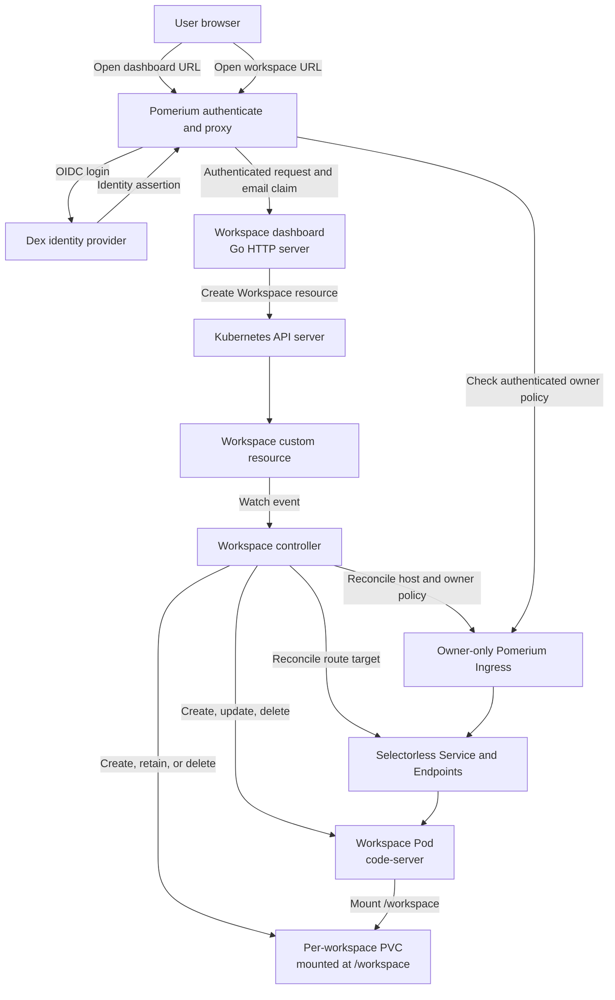

# Docker Workspaces

Docker Workspaces is a Kubernetes operator for creating browser-accessible
development environments from `Workspace` resources. A dashboard lets users
create, open, and delete their workspaces.

## How it works

The operator reconciles each `Workspace` resource into Kubernetes workload
objects: a Pod running code-server, a PVC mounted at `/workspace`, a Service,
and an owner-only Pomerium Ingress. The dashboard and workspace URLs are routed
through an authenticated proxy. In the included local setup, those URLs resolve
only on the development machine; they are not public internet endpoints.

## Architecture



## Reconciliation flow

1. The dashboard or `kubectl` creates or updates a `Workspace` resource.
2. The controller reconciles a per-workspace Pod and PVC.
3. The Pod runs code-server and mounts the PVC at `/workspace`.
4. The controller creates a selectorless Service and Endpoints.
5. Pomerium routes the owner-specific hostname to that Service.
6. Pod and PVC events trigger further reconciliation until the desired state is reached.

`StoragePolicy: Delete` removes the Pod and PVC with the Workspace.
`StoragePolicy: Retain` removes the Pod but preserves an independently managed PVC.

## Getting started

See the [local development guide](docs/local-development.md) to create a Kind
cluster, configure local authentication and routing, and deploy the operator.

Useful development commands:

```sh
make test
make lint
make test-e2e
```

End-to-end tests create and delete their own Kind cluster. Run them only when
that isolated cluster can safely be created on your machine.

## Security and production considerations

This project is intended for local development and learning. Workspace
containers run as Kubernetes Pods with PVC-backed storage. The editor routes
also rely on Pomerium for access control. It does not yet provide production-grade
workload isolation, backup, or storage recovery.

Before deploying for multiple users, review the [security and production
considerations](docs/security-and-production.md) and design suitable
isolation, access control, storage, and operational safeguards.

## Project layout

- `api/` and `internal/`: Workspace API, Kubernetes provider, controller, dashboard, and webhook.
- `config/`: Kubernetes resources, samples, and local development configuration.
- `docs/`: Development and security guidance.
- `scripts/`: Local development helpers.
